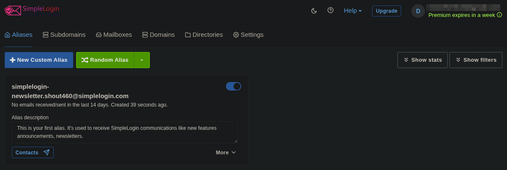

# SimpleLogin – How To

## About

[SimpleLogin](https://simplelogin.io/) is a service for making multiple email aliases. An email alias is an email address that, when it receives an email, forwards it to your real email. This means you can create a different email to use for a service, like Facebook or Netflix, and when the alias is sent an email, it will be forwarded to your real email.

**NOTE:** This may not work on ALL services. Some services will not let you use an alias. It will work on most, though.

This is helpful for multiple reasons. You have the ability to turn an email on/off at will, so you can turn off an email that gets a bunch of spam but turn it back on if you need to purchase something from the website again.

It's also great for keeping your real personal email private from companies that sell your data - or, if a company gets breached (hacked), the hackers won't have your real email address.

This comes with two options: free and paid. With a free account, you get 10 aliases that forward to your real email. For example: make one email for social media, one for online shopping, one for random things that require an email, etc.

They also have a paid version ($36/yr) that I recommend if possible, so you can make as many aliases as you want. I personally use this one so I can have an individual alias for each account. It's much easier to manage and turn off spam.

## Starting

This is very simple and painless, I promise.

To start, I recommend making a new email account, so you can have a fresh email address clean of any spam and junk mail. I use and recommend [ProtonMail](https://mail.proton.me/), but you can also use [Google's Gmail](https://mail.google.com/mail).

[Sign up with SimpleLogin](https://app.simplelogin.io/auth/register) with your new (or existing) email address. Once logged in and your email is verified, you'll be taken to the SimpleLogin dashboard.

<figure><figcaption></figcaption></figure>

## Using

From here I HIGHLY recommend grabbing the SimpleLogin extension for your browser:

* [Chrome](https://chromewebstore.google.com/detail/simplelogin-by-proton-sec/dphilobhebphkdjbpfohgikllaljmgbn?pli=1)
* [Firefox](https://addons.mozilla.org/en-US/firefox/addon/simplelogin/)
* [Safari](https://apps.apple.com/us/app/simplelogin-for-safari/id6475835429?mt=12)
* [Edge](https://microsoftedge.microsoft.com/addons/detail/simpleloginreceive-sen/diacfpipniklenphgljfkmhinphjlfff)

On the dashboard, if you are making one alias for multiple services, click the "+ New Custom Alias" button in the top left.

<figure><figcaption></figcaption></figure>

From here, choose an alias name and change your domain. You may be limited depending on whether you are using the free or paid account. For example, if using the free account and you want an email for online shopping, you can name it "shopping." Then click create.

<figure><figcaption></figcaption></figure>

Going back to your dashboard, you should see the alias you just created along with the default one created by SimpleLogin. You can delete the one from SimpleLogin.

<figure><figcaption></figcaption></figure>

From here, either sign up to online shopping like Amazon or Etsy with your new alias, OR log into your existing account on the service and change your email to the alias.

## Using the Add-On/Extension

If you have the premium version or want to use the add-on/extension, you can quickly and easily make aliases. On the website you want to make an alias for - Netflix in my example - click the icon for the add-on/extension. This will auto-fill the website name into the field and let you know you are going to create a new alias.

<figure><figcaption></figcaption></figure>

You can click create, and then you can click the email to copy it and paste it where needed.

<figure><figcaption></figcaption></figure>

From the add-on/extension, you can also toggle aliases on/off to stop/start getting emails sent to that alias.

<figure><figcaption></figcaption></figure>

Ta-da! You're all set! You can easily stop getting spam now by signing up for junk services with a junk alias, and keep your real, personal email address hidden and safe!
